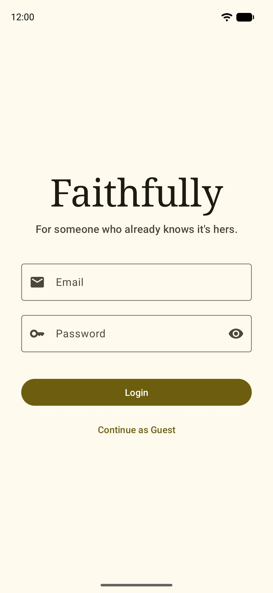
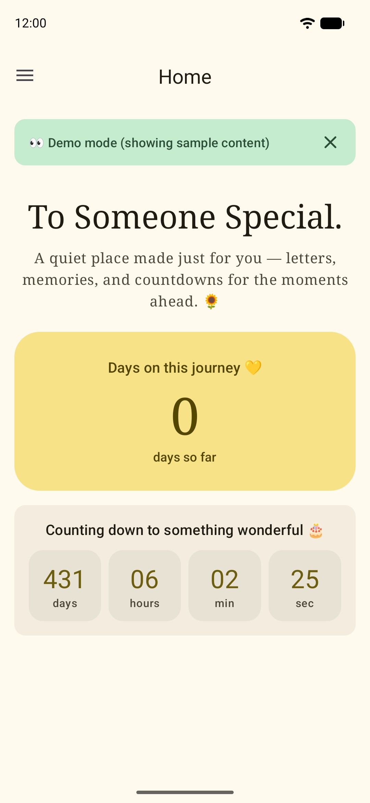
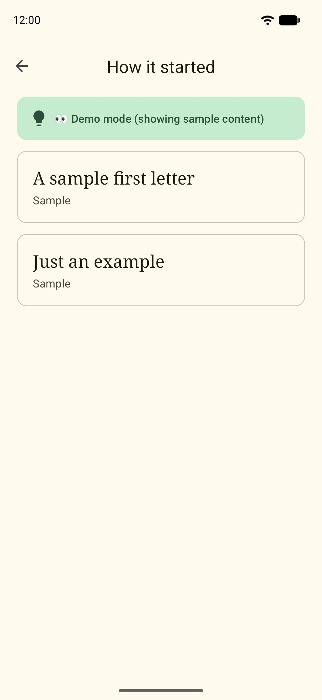
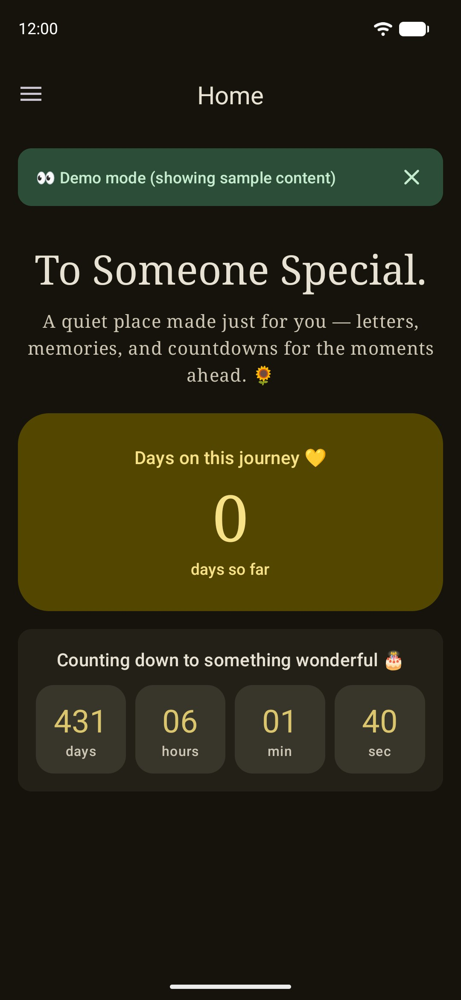

<div align="center">

# 🌻 Faithfully App

### *The Android app I built to manage her letters, memories, and photos.*

A small Java + XML app that lets me write letters, organize them into chapters, and upload cat photos, all syncing in real time to a public website I built for her. Fully private for the two of us, with a friendly demo mode for everyone else.

**[🌐 Website repo](https://github.com/mowtiie/Faithfully-Web)** · **[🌐 Live site](https://alliyannah.love)**

</div>

---

## 💛 Why I built this

The website I made for her ([Faithfully Web](https://github.com/mowtiie/Faithfully-Web)) needed a way for me to add new letters and photos from anywhere, without editing JSON files or pushing to a repo every time. So I built the admin side: a small Android app, signed in silently as me, that talks to the same Firebase backend the site reads from.

I picked Java and XML views instead of Kotlin and Compose on purpose. It's the stack I'm most comfortable with from my coursework, and I wanted to focus on the polish of the actual UX rather than fighting a new language while building something personal.

---

## ✨ Features

### 🏠 Home
- 🎂 Live countdown that ticks down to the second
- 💛 Days-together counter that counts up from the day we began
- 🌻 Title, subtitle, and labels all come from the same `settings/home` document the website reads, so the two always agree
- 🌙 Light and dark mode, three contrast levels, and optional dynamic color

### 💌 Letters
- 📖 Chapters that group letters into eras of our story: add, edit, delete, and reorder
- 💌 Letters written with a built-in date picker, assigned to a chapter, and editable later
- 🔀 Long-press any chapter or letter to drag it into a new position
- 🏷️ Move a letter to a different chapter, or unassign it entirely

### 🐱 Gallery
- 🖼 Photo upload with the system photo picker, no storage permission needed
- 🪶 Automatic compression: full photo resized to 1920px plus a 400px thumbnail, JPEG-compressed to roughly 10x smaller
- 🔃 EXIF orientation is read so portrait photos don't end up sideways
- 📝 Optional captions, editable later from the long-press menu
- ☁️ Photos live on Cloudflare R2, the same place the website serves them from. Old Firebase Storage photos still show up
- 🗑️ Deleting a photo removes both the full-size image and its thumbnail

### 💾 Backup & Restore
- 📦 Export everything (chapters, letters, photos, apps, and home settings) to a single `.zip`
- ♻️ Restore from a backup: it uses the same zip format as the website's backup
- 🧹 Clear all data behind a type-DELETE-to-confirm step
- 🔒 Admin only, found in Settings

### 🔐 Auth & Demo mode
- 🔑 Email/password sign-in; only the two allow-listed accounts unlock the real content
- 👑 **Admin** (me): add, edit, delete, reorder, upload, and back up
- 🩷 **Reader** (her): sees everything for real, but read-only, with a soft banner saying so
- 👀 **Guest** (everyone else): a demo mode with placeholder chapters, sample letters, and free stock cat photos, so visitors can see the layout without seeing anything personal. It never touches Firebase
- 🛡️ Every write is checked twice: the UI hides the buttons, and the code refuses to write unless you're the admin

### 🧰 Under the hood
- ⚡ Real-time updates through Firestore listeners that detach with their screen
- 💾 Chapters are cached in SQLite so the list opens instantly, and the cache is cleared on sign-out so nothing leaks to the next person
- 🔄 Atomic batch writes for every reorder: no half-updated lists
- 🎨 Material 3 styling with theme-aware colors, so dragged cards lift with a soft color shift
- 🔒 Two-layer security: client-side role checks plus Firestore and Worker rules that require the admin UID

---

## 📸 Screenshots

| Login | Home | Letters | Dark mode |
|:---:|:---:|:---:|:---:|
|  |  |  |  |

---

## ✅ Verification

APK releases on GitHub are signed using my key. They can
be verified using
[apksigner](https://developer.android.com/studio/command-line/apksigner.html#options-verify):

```
apksigner verify --print-certs --verbose faithfully.apk
```

The output should look like:

```
Verifies
Verified using v1 scheme (JAR signing): false
Verified using v2 scheme (APK Signature Scheme v2): true
Verified using v3 scheme (APK Signature Scheme v3): false
Verified using v3.1 scheme (APK Signature Scheme v3.1): false
Verified using v3.2 scheme (APK Signature Scheme v3.2): false
Verified using v4 scheme (APK Signature Scheme v4): false
```

The certificate fingerprints should correspond to the ones listed below:

```
Owner: CN=Mowtiie
Issuer: CN=Mowtiie
Serial number: 8a256fdcdde50069
Valid from: Wed Jun 10 22:57:23 PST 2026 until: Sun Oct 26 22:57:23 PST 2053
Certificate fingerprints:
         SHA1: 56:4E:2C:DB:E4:06:C9:EC:15:E6:BC:D9:0A:88:38:72:8B:FB:13:20
         SHA256: 8B:67:51:F3:C3:31:85:63:5F:98:95:30:B6:C0:73:A1:39:7B:3D:41:2B:EF:AE:69:06:A2:EB:58:45:D2:DE:63
```

---

## 🛠️ Tech stack

| Layer | What I used |
|---|---|
| **Language** | Java |
| **UI** | XML views (no Compose) with Material 3 components |
| **Database** | [Firebase Firestore](https://firebase.google.com/docs/firestore) (real-time NoSQL) |
| **Photo storage** | [Cloudflare R2](https://developers.cloudflare.com/r2/) behind a small upload Worker, the same one the website uses |
| **Legacy storage** | [Firebase Storage](https://firebase.google.com/docs/storage), only for photos uploaded before the move |
| **Auth** | [Firebase Auth](https://firebase.google.com/docs/auth): email/password, UID-restricted writes. The same ID token authorizes uploads to the Worker |
| **Local cache** | Android SQLite via `SQLiteOpenHelper` |
| **Image loading** | [Glide](https://github.com/bumptech/glide) |
| **Image processing** | Built-in `Bitmap` + AndroidX `ExifInterface` (resize, rotate, JPEG-encode) |
| **Min SDK** | 24 (Android 7.0+) |
| **Companion** | [Faithfully Web](https://github.com/mowtiie/Faithfully-Web): the public website |

---

## 🏗️ Architecture

```
      ┌──────────────────┐         ┌─────────────────┐         ┌─────────────────┐
      │  Admin           │         │  Reader         │         │  Everyone else  │
      │  (signed in)     │         │  (signed in)    │         │  (demo mode)    │
      └────────┬─────────┘         └────────┬────────┘         └────────┬────────┘
               │ reads + writes             │ reads                     │ reads
               │ (UID-restricted)           │ (UID-restricted)          │ sample content
               │                            │                           │ from mock_data.json
               └───────────┬────────────────┘                           │
                           ▼                                            ▼
             ┌────────────────────────────────┐             (no Firebase call)
             │  Firebase                      │
             │   • Firestore                  │
             │     - chapters/                │
             │     - cards/                   │
             │     - gallery/                 │
             │     - settings/home            │
             │   • Auth                       │
             │     - allow-listed UIDs only   │
             └────────────────────────────────┘

             ┌────────────────────────────────┐
  Admin ───► │  Upload Worker  (admin token)  │ ───► Cloudflare R2
  uploads    └────────────────────────────────┘       - gallery/*.jpg
  deletes                                             - gallery/thumbs/*.jpg
```

The admin account is the only one that can write. Firestore rules check the user's UID on every write, and the upload Worker only accepts the admin's Firebase ID token, so even though other people can sign in, they cannot change anything. The website reads the same Firestore documents and loads the same R2 photos.

---

## 📁 Project structure

```
app/src/main/java/com/mowtiie/faithfully/
├── FaithfullyApp.java             # applies the saved theme at startup
│
├── ui/activities/
│   ├── LoginActivity              # sign in or continue as guest
│   ├── HomeActivity               # title, countdown, and days-together counter
│   ├── MainActivity               # chapters list
│   ├── CardsActivity              # letters inside a chapter
│   ├── AddChapterActivity         # add or edit a chapter
│   ├── AddCardActivity            # add or edit a letter
│   ├── GalleryActivity            # photo grid + admin actions
│   ├── AddPhotoActivity           # picker + compress + upload
│   ├── PhotoViewerActivity        # full-screen photo
│   ├── SettingsActivity           # preferences + admin-only backup, restore, clear all
│   ├── AboutActivity
│   └── FaithfullyActivity         # base class: contrast + dynamic color
│
├── ui/adapters/                   # Chapter, Card, Photo, and notice-banner adapters
├── data/                          # Chapter, Card, Photo models
│
├── helper/
│   ├── AuthHelper                 # admin / reader / guest detection
│   ├── PhotoStorageHelper         # R2 upload Worker client
│   ├── BackupManager              # zip export, restore, clear all
│   ├── HomeContentResolver        # sample text vs settings/home, countdown math
│   ├── MockDataLoader             # demo content from assets/mock_data.json
│   ├── ChapterDbHelper            # SQLite cache for chapters
│   └── NetworkHelper
│
└── util/ImageUtil                 # resize, rotate, JPEG-encode
```

---

## 📤 Upload pipeline (gallery)

When you tap the upload button:

1. **System photo picker** opens (no permissions required)
2. **On a background thread**, the chosen image is:
   - decoded with `inSampleSize` to avoid running out of memory on huge photos
   - rotated based on EXIF orientation
   - resized to **1920px wide** (full-res) and **400px wide** (thumbnail)
   - JPEG-compressed (quality 85 / 80)
3. **Two uploads** go to the Worker with my Firebase ID token: `gallery/<time>_<id>.jpg`, then `gallery/thumbs/<time>_<id>.jpg`. If the thumbnail fails, the full image is removed again
4. **Firestore document** created with both public URLs, the two storage keys, an optional caption, and an auto-incremented `order`. If this step fails, the uploaded files are deleted
5. The website's real-time listener picks it up → the photo appears in the gallery within about a second

A typical 5MB phone photo becomes ~350KB total uploaded.

---

## 🔧 Running it yourself

If you want to fork it and run your own version:

1. Clone the repo and open it in Android Studio
2. Create a Firebase project at [console.firebase.google.com](https://console.firebase.google.com)
3. Enable Firestore and Authentication (Email/Password)
4. Create your admin user under **Authentication → Users**
5. Put your admin's UID (and the reader's, if you have one) in `AuthHelper.java`, and write matching Firestore security rules
6. Drop your `google-services.json` from Firebase into the `app/` folder
7. Set up an R2 bucket and an upload Worker that only accepts your admin's Firebase ID token, then point `UPLOAD_WORKER_URL` and `PHOTO_BASE_URL` in `PhotoStorageHelper.java` at them
8. Run on a device or emulator

Release builds read their signing details from a git-ignored `keystore.properties`; without it they build unsigned, which is handy for CI.

Without signing in, you'll still see the app, just guest mode with the placeholder content from `app/src/main/assets/mock_data.json`. The first launch shows the login screen; after you sign in, Firebase keeps the session and the app skips straight to Home.

---

## 🧠 What I learned

- How to combine a real-time cloud database with a local SQLite cache without conflict
- Building drag-and-drop reorder with `ItemTouchHelper` and committing the result as a Firestore batch write so it's atomic
- That offline-first UI feels noticeably better: chapters appear from cache instantly while Firestore catches up
- Material 3's color system (`MaterialColors.getColor()`) makes themed drag states elegant in just a few lines
- How to design a clean three-role auth flow (admin, reader, guest) where the UI and the backend rules both enforce permissions
- How to do image processing right: EXIF rotation, `inSampleSize`, JPEG quality tradeoffs, dual-size uploads for thumbnails
- That a shared storage layer is worth it: letting a small Worker check the same Firebase ID token meant no secrets in the app

---

## 👤 Made by

**Her Mowtiie.**

Made with 🌻 for someone who already knows it's hers.
